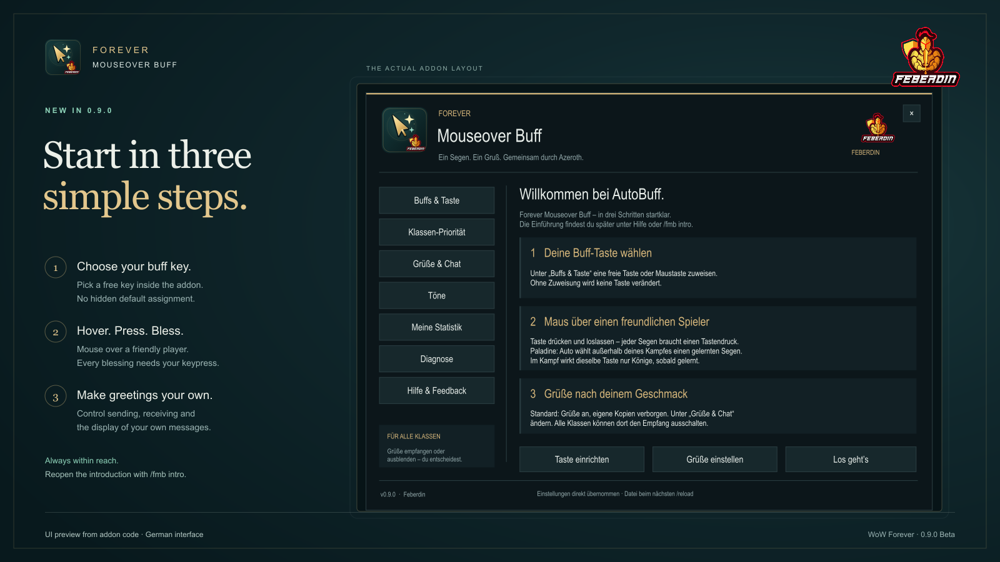
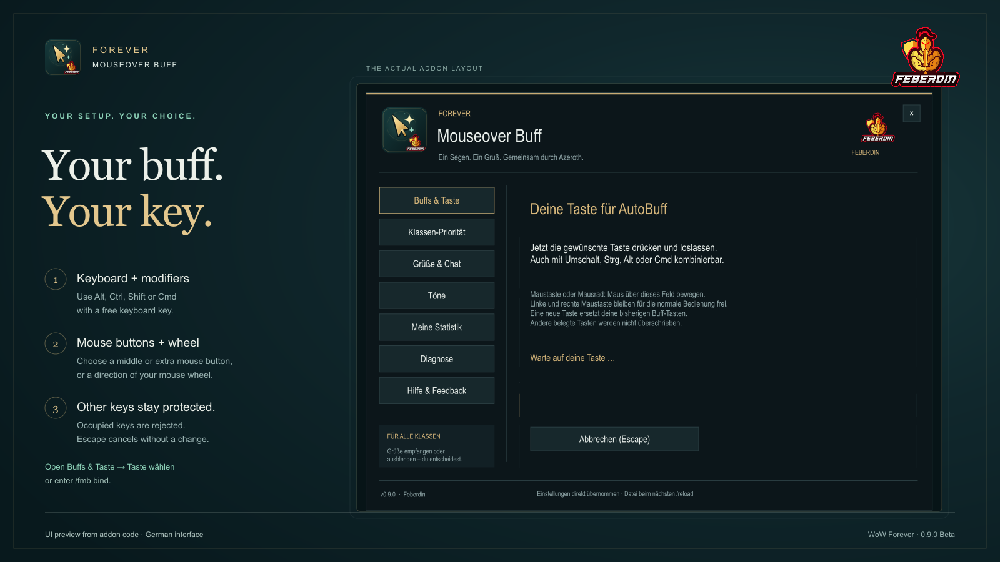

# Forever Mouseover Buff

**[English](README.md)** · [Änderungen](CHANGELOG.md) · [Mitmachen](CONTRIBUTING.md) · [Feberdin-Design](BRANDING.md)

**Ein passender Segen. Ein persönlicher Gruß. Ein ruhigerer Chat.**

Wähle einen gelernten Klassenbuff für den befreundeten Spieler unter deiner
Maus. Paladin, Magier, Priester, Druide, Hexenmeister und Schamane haben eigene
Buffprofile. Alle Klassen können Grüße empfangen und automatisch danken.

**0.10.0 Beta · WoW Forever 1.60.1 · Interface 16001**

Oberfläche und Grüße sind überwiegend deutsch. Klassenprioritäten und das native
Sanctum-Menü sind automatisiert und im nachgebildeten Layout geprüft. Die
Ingame-Abnahme und der tatsächliche Grußempfang bei einem anderen Spieler stehen
noch aus.

## Klassenbuffs (0.10.0 Beta)

| Deine Klasse | Auto in dieser Reihenfolge | Zusätzlich bewusst wählbar |
| --- | --- | --- |
| Paladin | Bestehende Zielklassen-Prioritäten für Macht/Weisheit/Könige | Jeder Segen einzeln |
| Magier | Arkane Intelligenz; überspringt Krieger/Schurken | Magie dämpfen, Magie verstärken |
| Priester | Seelenstärke → Willenskraft → Schattenschutz | Jede Bufffamilie einzeln |
| Druide | Mal der Wildnis → Dornen | Jede Bufffamilie einzeln |
| Hexenmeister | Unterwasseratmung → Unsichtbarkeit entdecken | Jede Bufffamilie einzeln |
| Schamane | Wasseratmung | Wasserwandeln |

Wähle den gewünschten gelernten Zauber unter **Buffs & Taste**. Intelligenz und
Willenskraft werden bei Kriegern/Schurken in Auto ausgelassen. Gleichartige Buffs
bleiben erhalten, einschließlich lesbarer Gebets-, Gaben- und Brillanz-Varianten.
Andere Klassen dürfen eine zweite fehlende Bufffamilie ergänzen; nur Paladine
behalten ihre besondere Regel zum Erhalt des eigenen bestehenden Segens.
Magie dämpfen/verstärken verändert auch eingehende Heilung; Wasserwandeln verändert
die Bewegung. Diese Zauber musst du bewusst auswählen. Schamanenbuffs verbrauchen
Reagenzien. FMB prüft WoWs Zaubernutzbarkeit und Manaauskunft, **zählt Reagenzien
aber nicht selbst**. Fehlende Gegenstände können erst beim Zaubern gemeldet werden.

Es werden nur tatsächlich gelernte Zauberbuchränge und aktuelle Reichweiten-/
Nutzbarkeitsdaten verwendet. Vorsichtig gilt: Lernstufe des Rangs ≤ Zielstufe.
Das ist eine Addon-Sicherheitsregel und **keine Aussage über WoWs Mindestzielstufe**;
manuell können eventuell höhere Ränge möglich sein. Automatische Heilung und feste
Könige im Kampf bleiben Paladin-Funktionen. Andere Klassen buffen nur außerhalb
des eigenen Kampfes. Wiederbelebungen, Gruppenbuffs, Rufe, Totems, Aspekte,
kurzzeitige Abklingzeitbuffs, Begleiter-, Waffen- und Eigenbuffs gehören nicht zu
diesem Ablauf. Neue Klassenbuffs erzeugen keine Paladin-Zähler oder Exporte.

## 🛡️ Paladin-Funktionen

- **Segen per Mouseover:** Außerhalb deines eigenen Kampfes wählt es anhand der
  unterstützten Klassenvorgaben einen passenden gelernten Segen der Macht,
  Weisheit oder Könige.
- **Mit derselben Taste heilen:** Außerhalb deines eigenen Kampfes und im
  Stillstand wird für ein freundliches Mouseover-Ziel mit weniger als 50% Leben
  ein gelernter, nutzbarer Lichtblitz gewählt, sonst ein gelernter, nutzbarer
  Heiliges-Licht-Zauber. Eine Heilung sendet keinen
  Buff-Gruß und zählt nicht zur Buffstatistik oder Rangliste.
- **Vorhandene Buffs berücksichtigen:** Die Auswahl verwendet lesbare
  Zielinformationen und erhält bestehende Segen. Sind wichtige Angaben unklar
  oder geschützt, hält sie mit einer verständlichen Begründung an.
- **Taste im Kampf:** Sobald gelernt, liegt Segen der Könige im eigenen Kampf
  fest auf derselben Mouseover-Taste. Dabei findet keine dynamische Auswahl statt.
- **Rückmeldung erhalten:** Ein gesperrter Versuch wird kurz erklärt und auf
  Wunsch mit einem Ton gemeldet. Ein eigener Hinweiston erinnert an einen
  beobachteten natürlichen Siegelablauf.
- **Persönliche Grüße senden:** Nach einem bestätigten FMB-Buff kann ein
  wechselnder Gruß mit passender Klassen-/Volkssprache und, soweit verfügbar,
  dem Link zum tatsächlich gewirkten Zauber verschickt werden.

**Jeder Zauber benötigt einen echten Tastendruck.** Bloßes Drüberfahren mit der
Maus zaubert nichts. Direkte Buffs unterstützen **sechs Klassen**. Krieger,
Jäger und Schurken erhalten eine Erklärung ihrer Klassengrenzen. Gruppen-,
Waffen- und Eigenbuffs bleiben bei der normalen WoW-Bedienung. Statistik,
gesendete Segensgrüße und der bestehende Rankingdienst bleiben **Paladin-Funktionen**.

## 🚀 Schnell eingerichtet

1. Installiere das Addon im aktiven Forever-Ordner `Interface/AddOns`. Bei einer
   manuellen ZIP-Installation muss dort
   `ForeverMouseoverBuff/ForeverMouseoverBuff.toc` liegen.
2. Starte WoW nach der ersten Installation neu. Bei einem Update reicht
   normalerweise `/reload`.
3. Folge der kurzen Einführung. Mit `/fmb` öffnest du später die Einstellungen.
4. Mit einer unterstützten Buffklasse wählst du im Addon **Taste einrichten** oder gibst `/fmb bind` ein
   und vergibst eine freie Taste. Fahre über einen freundlichen Spieler, drücke
   die Taste und lasse sie wieder los.
5. Du möchtest nur die Grüße abschalten? Gib `/fmb receive off` ein. Dafür
   brauchst du weder einen Paladin noch eine Buff-Taste.

`/fmb auto` aktiviert die automatische Auswahl außerhalb des Kampfes. Mit
einem Klassenbuff unter **Buffs & Taste** wählst du einen festen Modus.
Paladine können weiterhin `/fmb might`, `/fmb wisdom` und `/fmb kings` nutzen.
`/fmb on` und `/fmb off` schalten die Bufffunktion ein oder aus.

Beim Öffnen von Feedback wird das Hauptmenü ausgeblendet. Schließen oder Escape
führt zur bisherigen Seite zurück. Direkt geöffnetes Feedback (`/fmb feedback`)
schließt wieder ohne Hauptmenü, wenn es vorher nicht geöffnet war.

## Paladin: Mit einer Taste heilen und buffen (0.10.0)

Behalte deine bisherige FMB-Taste. Stehe außerhalb deines eigenen Kampfes still
und fahre mit der Maus über ein freundliches Ziel mit **strikt weniger als 50%
Leben**. Dein bewusster Tastendruck versucht dann eine Heilung: Ein gelernter,
nutzbarer **Lichtblitz** hat Vorrang; andernfalls wird gelerntes, nutzbares
**Heiliges Licht** gewählt. Der Zauber muss auch in Reichweite sein. WoW kann
den Zauber weiterhin verhindern, etwa bei blockierter Sichtlinie.

Bei genau 50% oder mehr Leben sowie während deiner Bewegung bleibt die übliche
Segenauswahl aktiv. Im eigenen Kampf liegt weiterhin der fest vorbereitete
Segen der Könige auf der Taste. Heilungen senden keine Buff-Grüße und erhöhen
weder Buffstatistik noch Ranglistenzähler. Tasteneinrichtung, Segenvorgaben und
verständliche Statushinweise bleiben verfügbar.

## Kurze Einführung und deine eigene Buff-Taste

Die Einführung erscheint beim ersten Start pro Charakter automatisch. Ab 0.9.1
sehen auch bisherige Nutzer ohne Buff-Taste die verbesserte Einführung einmal,
selbst wenn die frühere Einführung schon als gesehen gespeichert war. Bereits
belegte Tasten bleiben erhalten. Bei einem Start im Kampf wartet die automatische
Einführung bis zum Kampfende.

**„Keine Buff-Taste belegt – bitte jetzt einrichten!“** zeigt dir direkt, was noch
fehlt: Klicke auf **Jetzt Taste einrichten** und drücke eine freie eigene Taste.
Danach zeigt die Einführung deine tatsächliche Belegung und **Taste ändern** an.
Ohne Taste kannst du nicht buffen; bloßes Mouseover löst keinen Zauber aus.
Mit **Später einrichten** oder dem Schließen überspringst du die Einführung
bewusst; sie erscheint bei späteren Logins nicht immer wieder. Mit `/fmb intro`
öffnest du sie jederzeit erneut. Einstellungen bleiben erhalten; ein Tastendruck
auf eigene Initiative ist für jede Zuweisung erforderlich.

Öffne `/fmb bind` oder **Buffs & Taste → Taste wählen**. Starte die
Tastenerfassung und drücke eine freie Tastaturtaste, bei Bedarf zusammen mit Alt,
Strg, Umschalt oder Cmd auf dem Mac. Auch die mittlere Maustaste, Maustaste 4/5
und das Mausrad sind möglich. Linke und rechte Maustaste bleiben für die normale
Bedienung frei.
Gespeichert wird im aktuell aktiven WoW-Belegungssatz: accountweit oder nur für
diesen Charakter. Eine neue freie Taste ersetzt die bisherigen FMB-Tasten.
Wählst du eine bereits FMB zugewiesene Taste, bleibt deren Belegung unverändert.

Eine schon anderweitig belegte Taste wird mit einer Erklärung abgelehnt. Wähle
eine freie Kombination oder gib die Taste bewusst in WoWs Tastaturbelegung frei.
Escape, Fensterschließen oder Kampfbeginn bricht die Erfassung ab. Änderungen sind
nur außerhalb des Kampfes möglich. Das Entfernen der Buff-Belegung betrifft nur
FMB-Tasten. Es wird keine Taste automatisch vergeben; die Einrichtung löst keinen
Zauber aus. **Tastaturbelegung → Forever Mouseover Buff** bleibt ebenfalls nutzbar.

*Vorschau aus dem Addon-Code · deutsche Oberfläche; keine Ingame-Aufnahme.*

## Paladin-Prioritäten je Zielklasse

Öffne `/fmb priorities` oder im Menü **Klassen-Priorität**. Wähle die Klasse des
Empfängers, schalte die gewünschten Segen ein und ordne sie mit **Hoch** und
**Runter**. Gewählt wird der erste aktive, fehlende, gelernte und zur Zielstufe
passende Segen. Sind alle drei ausgeschaltet, wird diese Klasse im Automodus
übersprungen. **Standard wiederherstellen** setzt nur die gewählte Klasse zurück.
Die Einstellungen werden pro eigenem Charakter bei Reload oder Logout gespeichert.

Für Druiden gilt standardmäßig **Könige → Weisheit → Macht**. Hat ein Druide
Könige und Weisheit von anderen Paladinen, kannst du Macht ergänzen. Bereits
vorhandene gleichartige Segen bleiben unabhängig vom Rang erhalten. Auch dein
eigener Macht-, Weisheit- oder Könige-Segen bleibt stehen, selbst wenn du ihn aus
der Liste entfernst. So ersetzt wiederholtes Drücken nicht ständig deinen eigenen
Segen. Die Liste wählt einen passenden Segen; sie ermöglicht keine drei gleichzeitigen
Segen desselben Paladins. Für einen bewussten Wechsel bleibt der feste Modus verfügbar.

Die Reihenfolge gilt ausschließlich bei **Auto außerhalb des Kampfes**. Im Kampf
bleibt die Taste auf gelerntem Könige; feste Modi ignorieren die Klassenliste.
Einstellungen lösen keinen Zauber aus. Unklare Auren sperren weiterhin die Auswahl.
`INVALID_PRIORITIES` meldet ungültige gespeicherte Prioritäten: Liste im Menü
korrigieren oder mit `/fmb priorities reset` bewusst **alle** Klassen zurücksetzen.
`CLASS_DISABLED` bedeutet: Alle Segen für die aktuelle Zielklasse sind ausgeschaltet.

## 💬 Drei unabhängige Nachrichtenschalter

| Dein Wunsch | Befehl | Das wird geändert |
| --- | --- | --- |
| Keine eigenen Grüße versenden | `/fmb whisper off` | Deine ausgehenden automatischen Grüße |
| Keine FMB-Grüße empfangen | `/fmb receive off` | Automatische Grüße an dich |
| Eigene Grüße in Chat und WIM verbergen | `/fmb outgoing off` | Deine Anzeige, Popups und WIM-Töne |

Unter **Grüße & Chat** gibt es getrennte Schalter für **Automatische Grüße
senden** und **Eigene Grüße verbergen**. Beide stehen standardmäßig auf **AN**:
Der Empfänger bekommt deinen Gruß, deine eigene Kopie bleibt in Chat und WIM
verborgen. Schalte den Versand aus, um keine automatischen Nachrichten mehr zu
senden; Buffen funktioniert weiter. Bereits bewusst gesetzte Einstellungen
bleiben erhalten. `/fmb outgoing on` zeigt eigene Kopien wieder an.

Verborgene automatische Grüße öffnen kein WIM-Fenster, lösen dort keinen Ton aus
und landen nicht im WIM-Verlauf. Persönliche Whisper bleiben unverändert. WIM ist
optional. Gefiltert werden ausschließlich kürzlich gesendete automatische Grüße
an den exakt passenden Empfänger. Der Empfangsschalter erkennt kompatible,
markierte FMB-Grüße; andere Addons oder ältere unmarkierte Nachrichten werden
nicht pauschal gefiltert.

## 🔔 Töne nach deinem Geschmack

- `/fmb sound on` beziehungsweise `/fmb sound off`: Ton bei gesperrten Buffversuchen.
- `/fmb soundtest`: den eingeschalteten Hinweiston prüfen.
- `/fmb seal on` beziehungsweise `/fmb seal off`: separate Siegelerinnerung.

Der Siegelton folgt einem beobachteten natürlichen Ablauf. Er ertönt nicht schon
deshalb, weil beim Einloggen kein Siegel aktiv ist.

## 📊 Lokale Statistik und freiwillige Rankingtests

`/fmb stats` zeigt lokale, unbestätigte Zähler erfolgreicher FMB-Buffs. Version
0.7.1 speichert die zwanzig unterstützten Zauberzähler als Binärdaten in Base64
mit einer SHA-256-Prüfsumme. Gültige ältere Zähler werden automatisch übernommen.
Beschädigte oder unlesbare Datensätze bleiben unverändert erhalten; die Statistik
pausiert, während Buffen weiterhin möglich ist.

**Das ist eine Kodierung mit Fehlerprüfung, keine Verschlüsselung oder
Manipulationssicherheit.** Wer die Dateien kontrolliert, kann auch neue Daten
mit passender Prüfsumme erstellen. Die Zähler bleiben selbst gemeldete
Community-Daten und beweisen keine echten Zaubervorgänge.

Der Rankingexport ist **standardmäßig aus**. `/fmb ranking on` sammelt freiwillig
Exportereignisse; `/fmb ranking help` erklärt den separaten Companion und den
lokalen Testablauf. Die Ereignisdatei bleibt lesbar. Empfänger und Chattexte
werden nicht exportiert. Das Addon baut keine Webverbindung auf, und es gibt
**keinen bereitgestellten öffentlichen Rankingdienst**. Companion und lokaler
Dienst sind zum Buffen nicht erforderlich.

## ✨ Sanctum-Menü im Spiel

`/fmb` öffnet das neue dunkle Menü mit deinem Feberdin-Ritter und Addon-Logo.
Links wechselst du zwischen Buffs und Tastenhilfe, Grüßen, Tönen, Statistik,
Diagnose und Hilfe. Türkise Schalter zeigen den aktuellen Zustand; Gold markiert
den gewählten Bereich und Segensmodus. Änderungen werden direkt übernommen.
Das Fenster passt sich kleineren Bildschirmen an und lässt sich mit Escape
schließen. Statistik und Diagnose zeigen echte lokale Werte, keine Beispieldaten.

## 💬 Fehler, Wünsche und Features melden

Öffne **Feedback & Hilfe auf GitHub** im Menü oder gib `/fmb feedback` ein.
Wähle Fehler, Wunsch oder Feature. Technische Angaben sind standardmäßig aus;
bei Aktivierung siehst du Version, öffentliche Schalter und höchstens fünf
bekannte Diagnosecodes in der Vorschau. Namen, Whisper und Zähler bleiben draußen.

Klicke **Link markieren**, kopiere mit Cmd/Strg+C und öffne den Link im Browser.
GitHub erhält die enthaltenen Angaben bereits beim Öffnen; du ergänzt und
veröffentlichst das Issue erst dort. Das Addon überträgt nichts und benötigt
keinen Token. [Schritt-für-Schritt-Hilfe und Vorlagen](docs/feedback.md).

## 🧭 Lokales Diagnoseprotokoll

`/fmb diag` zeigt den Diagnosestatus und die letzten fünf Ereignisse. Das begrenzte
lokale Protokoll enthält feste Codes, Schweregrad, Modul, soweit verfügbar öffentliche
Zeitstempel, Versuchs-/Erfolgs-/Fehlerzähler und einen kleinen Einstellungs- und
Clientstand. Spielernamen, GUIDs, Whispertexte und rohe API-Fehler werden nicht erfasst.
Das Protokoll arbeitet ohne Chatspam; `/fmb debug on` ergänzt nur die lokale Chatausgabe.

WoW schreibt die SavedVariables bei `/reload` oder beim Ausloggen auf die Festplatte.
Ein separater lokaler Leser kann diesen Stand ohne Rankingdienst und ohne Upload
prüfen. Er liest keinen Live-Spielzustand aus. Ein alter Dateistand ist keine aktuelle
Funktionsprüfung.

Details und lokale Abfragebefehle stehen im [Diagnoseprotokoll](DIAGNOSTICS.md).

## ❓ Häufige Fragen

**Kann ich jemanden buffen, der gerade kämpft?**  
Ja, der Kampfstatus des Ziels allein verhindert es nicht. Die Auswahl braucht
weiterhin verwendbare Zielinformationen. Dein eigener Kampf stellt die Taste
auf den gelernten Segen der Könige um.

**Was hilft bei einer Fehlermeldung?**  
Nutze `/fmb status`, `/fmb help` und vorübergehend `/fmb debug on`. Nenne im Fehlerbericht Addonversion, Clientbuild, Schritte zum
Nachstellen und den festen Diagnosecode. Danach schaltest du mit `/fmb debug off` zurück.
Teile keine vollständigen SavedVariables, privaten Whisper, Tokens oder
Zugangssicherungen. Sichere beschädigte Statistikdaten vor einem
Wiederherstellungsversuch; setze sie nicht nur zum Verbergen des Fehlers zurück.

## 🧰 Entwicklung, Support und Lizenz

Die [englische README](README.md#develop-and-test) enthält die lokal ausführbaren
Test- und Buildbefehle. [CONTRIBUTING](CONTRIBUTING.md) erklärt den Ablauf
Rot → Grün → Refactor; [SECURITY](SECURITY.md) beschreibt Daten und Schutzgrenzen.
Für eigene lokale Rankingtests gibt es die [Companion-Anleitung](companion/README.md)
und die [Service-Anleitung](service/README.md). Diese Komponenten sind nicht im
installierbaren Addon-ZIP enthalten.

Originaler Projektcode: [MIT](LICENSE). Das Ritterlogo kennzeichnet Feberdin als
Absender; die [Designvorlage](BRANDING.md) erklärt den Einsatz in weiteren eigenen
Addons. Eigenständiges Projekt ohne offizielle Verbindung zu Blizzard oder
CurseForge; Spielnamen und Marken verbleiben bei ihren jeweiligen Inhabern.

Quellcode: [Feberdin/ForeverMouseoverBuff](https://github.com/Feberdin/ForeverMouseoverBuff).
Fehlerberichte: [GitHub Issues](https://github.com/Feberdin/ForeverMouseoverBuff/issues).

### Einführung oder Tastenhinweis prüfen

Mit `/fmb intro` siehst du den aktuellen Tastenstatus; `/fmb bind` startet die
Tastenwahl direkt. Bei Kampfende wird eine automatisch vorgemerkte Einführung
geöffnet. `/fmb status` nennt Version und Belegung; `/fmb debug on` aktiviert
die vorhandenen lokalen Diagnosecodes, `/fmb debug off` schaltet sie aus.
Keine Tastenwerte werden zusätzlich in Diagnosecodes protokolliert. Wenn keine
Einführung erscheint, prüfe, ob das Addon im Charakterbildschirm aktiviert ist
und ob `/fmb status` Version 0.10.0 nennt.

### Verständliche Statushinweise (0.9.2)

Unter **Buffs & Taste** oder mit `/fmb status` stehen Ursache und nächster Schritt.
Keine Taste: nach dem Kampf `/fmb bind`. Außer Reichweite: näher herangehen.
Segen nicht gelernt: lernen oder `/fmb auto` wählen. Totes Ziel: einen lebenden
freundlichen Spieler wählen. Fehlende Daten: Maus neu aufs Ziel halten, kurz
warten und bei Dauerproblemen `/reload`; danach `/fmb diag` prüfen.
`/fmb debug on` protokolliert feste lokale Codes; anschließend wieder ausschalten.
Ein eigener vorhandener Segen bleibt absichtlich erhalten.

Bei allgemeiner Nichtnutzbarkeit und fehlgeschlagenen Kampfzaubern zählt die
WoW-Meldung. Mana, Abklingzeit oder Sichtlinie werden nicht als Ursache geraten.
Die Vorschau erzeugt keine Chatmeldungen. Fehlende Tasten werden auch im Kampf
erkannt, ohne Zieldaten zu lesen oder geschützte Schaltflächen zu ändern.

### Lokale Erweiterung: automatisch danken (07.11.2026)

Unter **Grüße → Automatisch für Buffs danken** oder `/fmb thanks on|off`
(Standard AN) bedankt sich das Addon mit dem nativen `/danke` beim lesbaren
Buffgeber. Es wechselt kein Ziel und ruft keine Angriffs-/Zauberfunktion auf.
Klassische Buffs werden zwei Sekunden gebündelt, je Spieler höchstens einmal
pro Minute und insgesamt höchstens einmal alle fünf Sekunden bedankt. Unbekannte
oder geschützte Aura-/Spielerdaten werden ausgelassen; Ingame-Abnahme steht aus.
Start: `/reload`, Status: `/fmb status`, sofort aus: `/fmb thanks off`.
[Tests, Backup und Rücknahme](docs/auto-thanks-2026-11-07/REPORT.md).
