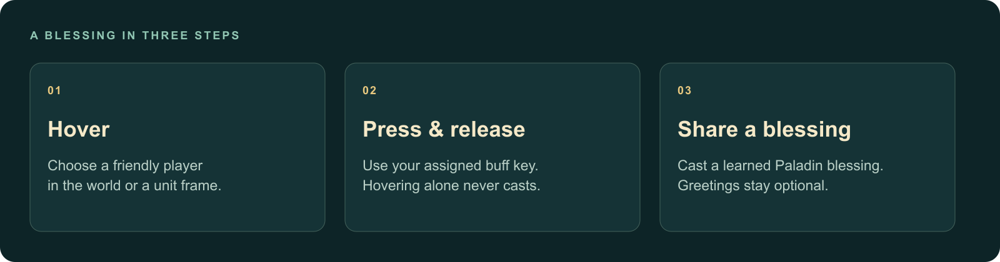
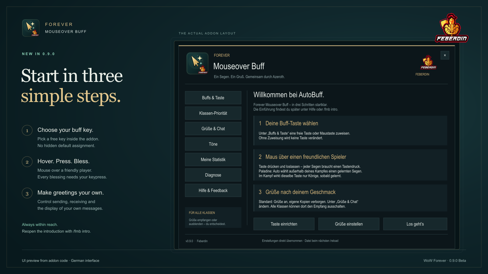
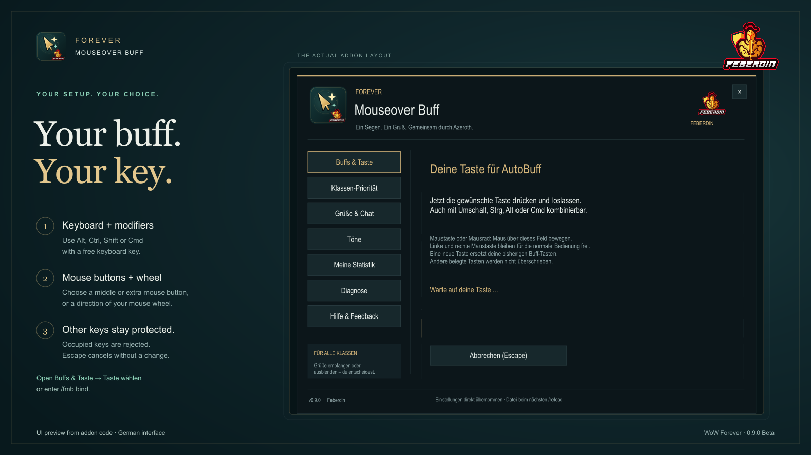

# Forever Mouseover Buff


**[Deutsch](README.de.md)** · [Quickstart](#-start-in-a-minute) · [Message controls](#-three-separate-message-controls) · [Changelog](CHANGELOG.md)

**A useful blessing. A personal greeting. A quieter chat.**

Choose a learned class buff for the friendly player under your mouse. Paladins,
Mages, Priests, Druids, Warlocks and Shamans have direct buff profiles. Every
class can receive greetings and use optional automatic thanks.

**0.10.0 Beta · WoW Forever 1.60.1 · Interface 16001**

The interface and greetings are primarily German. Class priorities and the native
Sanctum menu have automated behavior and offline layout coverage. Live gameplay
and receipt of greetings by another player still need in-game acceptance.

## Class buffs (0.10.0 Beta)

| Caster | Auto, in priority order | Explicit additional choices |
| --- | --- | --- |
| Paladin | Existing target-class Might/Wisdom/Kings priorities | Might, Wisdom, Kings |
| Mage | Arcane Intellect; skips Warriors/Rogues | Dampen Magic, Amplify Magic |
| Priest | Fortitude → Divine Spirit → Shadow Protection | Each family individually |
| Druid | Mark of the Wild → Thorns | Each family individually |
| Warlock | Unending Breath → Detect Invisibility | Each family individually |
| Shaman | Water Breathing | Water Walking |

Choose a learned spell in **Buffs & Taste**. Intelligence and Divine Spirit are
skipped for Warriors/Rogues in Auto. Existing equivalent buffs, including readable
Prayer/Gift/Brilliance equivalents, are retained. Other classes may add a second
missing family without the Paladin rule that preserves your one existing blessing.
Dampen/Amplify Magic alter incoming healing; Water Walking changes movement.
These utilities require an explicit choice. Shaman utility buffs consume native
reagents. FMB checks the client's spell usability and mana result; **it does not
independently count reagents**. WoW may reject a cast for missing items.

Only actual learned spellbook slots/ranks are used, with fresh range/usability
checks. Rank eligibility conservatively requires learned level ≤ recipient level;
this is an addon safety rule, **not a claim about WoW's minimum buff level**.
Rank choice may therefore be more restrictive than manual casting. Automatic
healing and fixed combat Kings remain Paladin features; other class casts are
blocked during the caster's combat. No resurrection, group/reagent buffs, party
shouts, totems, aspects, temporary cooldown buffs, pet/weapon or self buffs are
cast by this profile. New class buffs do not generate Paladin scores or exports.

## 🛡️ Paladin features

- **Mouseover blessings:** outside your own combat, choose a useful learned
  Blessing of Might, Wisdom or Kings from the supported class presets.
- **Heal with the same key:** outside your own combat, while standing still,
  a friendly mouseover below 50% health selects learned, usable Flash of Light,
  or learned, usable Holy Light as fallback. Healing sends no greeting or buff score.
- **Respect existing buffs:** selection uses readable target information and
  preserves existing blessings. When essential information is unclear or
  protected, it stops with a reason.
- **Combat binding:** once learned, Kings is available on the same mouseover key
  during your combat. This is a fixed binding, without dynamic buff selection.
- **Helpful feedback:** a blocked attempt gives a short explanation and an
  optional sound. A separate cue can announce an observed natural seal expiry.
- **Personal greetings:** after a confirmed FMB buff, send a rotating German
  greeting with appropriate class/race language and the actual spell link when
  available.

**Every cast requires a real keypress.** Hovering alone never casts a spell.
Direct buffs support **six classes**. Warriors, Hunters and Rogues receive a clear
explanation: their group, self or weapon actions are outside this single-player
mouseover workflow. Statistics, outgoing blessing greetings and the current
ranking service remain **Paladin-only**.



## 🚀 Start in a minute

1. Install the addon in your active Forever `Interface/AddOns` folder. For a
   manual ZIP installation, check that the folder contains
   `ForeverMouseoverBuff/ForeverMouseoverBuff.toc`.
2. Restart WoW after first installation. An update normally needs `/reload`.
3. Follow the short introduction. `/fmb` opens the controls later.
4. With a supported buff class, choose **Taste einrichten** in the addon, or enter `/fmb bind`,
   and assign a free key. Hover a friendly player, then press and release it.
5. Only want to decline greetings? Enter `/fmb receive off`. No buff binding is
   needed, and your character can be any class.

Use `/fmb auto` for automatic selection outside combat, or choose a class spell
in **Buffs & Taste**. Paladins can still use `/fmb might`, `/fmb wisdom` or `/fmb kings`. `/fmb on` and `/fmb off` control buff functionality.

Opening feedback hides the main menu. Closing or Escape returns to the previous
page. Standalone `/fmb feedback` closes without opening a previously closed menu.
Only one FMB window is visible at a time.

## Paladin healing and buffing with one key (0.10.0)

Keep your existing FMB key. Outside your own combat, stand still and hover a
friendly unit with **strictly less than 50% health**, then press the key to
attempt a heal. A learned, usable **Flash of Light** takes priority; otherwise
use learned, usable **Holy Light**. The selected spell must also be in range.
WoW can still prevent a cast, for example when line of sight is blocked.
Each heal requires your deliberate keypress.

At exactly 50% or more health, or while you are moving, the key follows the usual
blessing selection instead. During your own combat it keeps the fixed learned
Kings action. Healing does not send buff greetings and does not increase buff
statistics or ranking counters. Existing key setup, blessing preferences and
status guidance remain available.

## A short introduction and your own buff key

The introduction appears automatically on each character's first login. Starting
with 0.9.1, returning users without a buff key see the clearer setup once even if
they already saw the earlier introduction. Existing bindings are preserved.
Automatic opening waits until combat ends when logging in during combat.

**“Keine Buff-Taste belegt – bitte jetzt einrichten!”** states what is missing:
click **Jetzt Taste einrichten** and choose your own free key. Once assigned,
the introduction shows the actual key and **Taste ändern**. A buff requires
a deliberate key press. Choose **Später einrichten** or close the window to skip;
ordinary later logins keep the menu closed. Use `/fmb intro` to reopen it at any
time. Setup preserves preferences and only assigns a key after deliberate input.

Open `/fmb bind` or **Buffs & Taste → Taste wählen**. Start key capture and
press a free keyboard key, optionally with Alt, Ctrl, Shift or Cmd on a Mac.
You can also use the middle mouse button, mouse buttons 4/5 or the mouse wheel.
Left and right mouse buttons remain available for ordinary interaction.
The chosen key is saved
in WoW's currently active account-wide or character-specific binding set.
Choosing a new free key replaces the previous FMB keys. Selecting an existing
FMB key leaves its current assignments unchanged.

A key already assigned to another action is rejected with an explanation; choose
a free combination or free the key deliberately in WoW's key binding settings.
Escape, closing the window or entering combat cancels key capture. Binding
changes are available outside combat only. Removing the buff binding affects
only FMB's keys. No key is assigned automatically and setup never casts a spell.
The usual **Key Bindings → Forever Mouseover Buff** entry remains available.






*Preview from the addon code · German interface; not an in-game screenshot.*

## Paladin class priorities outside combat

Open `/fmb priorities` (or **Klassen-Priorität** in the menu). Choose a recipient
class, enable the blessings you want and move them with **Hoch** / **Runter**.
The first enabled, missing, learned and level-appropriate blessing is selected.
An empty list disables automatic buffs for that class. **Standard wiederherstellen**
restores only the selected class. Preferences are saved per character on reload/logout.

Druids default to **Kings → Wisdom → Might**. For example, a Druid with Kings and
Wisdom supplied by other paladins can receive your Might. Existing blessings of
the same family are preserved regardless of rank. Your own existing Might, Wisdom
or Kings is also preserved, even if excluded from the new list: this prevents
repeated key presses from replacing your own blessing in a cycle. This is an
ordered choice of one blessing, not three simultaneous blessings from one paladin.
Use an explicit fixed mode when you intentionally want to replace your own buff.

These settings apply only to **Auto outside combat**. The combat key remains fixed
to learned Kings; manual modes ignore class priorities. Settings never cast a spell.
Unreadable aura information still blocks selection. Invalid saved priorities block
Auto with `INVALID_PRIORITIES`; correct the list in the menu or deliberately use
`/fmb priorities reset` to restore **all** classes. `CLASS_DISABLED` means all
blessings for the current class have been switched off.

## 💬 Three separate message controls

| What you want | Command | What changes |
| --- | --- | --- |
| Stop sending automatic greetings | `/fmb whisper off` | Your outgoing greeting messages |
| Decline automatic FMB greetings | `/fmb receive off` | Greetings addressed to you |
| Hide your own greetings in chat and WIM | `/fmb outgoing off` | Your local display, popups and WIM sounds |

The **Greetings & Chat** page has separate **Send automatic greetings** and
**Hide my greetings** switches. Both default to **ON**: recipients receive your
greetings while your own copies stay quiet in ordinary chat and WIM. Switch
sending off to stop automatic messages without disabling buffs. Existing explicit
preferences remain saved; `outgoing on` shows your own copies again.

Hidden automatic echoes neither open WIM windows nor trigger its sounds or
history. Normal personal whispers remain unaffected. WIM is optional. The filter
matches only recently sent automatic messages and their exact recipient; the
receiver switch recognizes compatible, marked FMB greetings, rather than every
addon or older unmarked message.

## 🔔 Sounds you control

- `/fmb sound on` or `/fmb sound off`: feedback for blocked buff attempts.
- `/fmb soundtest`: check the feedback tone while it is enabled.
- `/fmb seal on` or `/fmb seal off`: the separate seal-expiry reminder.

The seal cue follows an observed natural expiry. It does not sound simply because
you log in without an active seal.

## 📊 Local counts and optional ranking experiments

`/fmb stats` shows local, unverified counts of successful FMB buffs. Version 0.7.1
stores the twenty supported spell counters as binary data encoded in Base64,
with a SHA-256 checksum. Valid older counters migrate automatically. Damaged or
unreadable records stay unchanged; statistic updates pause while buffing remains
available.

**This is encoding with a corruption check, not encryption or anti-cheat.** A
file owner can create another payload and matching checksum. Counts remain
community/self-reported and cannot prove genuine casts.

Ranking export is **off by default**. `/fmb ranking on` starts collecting optional
export events; `/fmb ranking help` explains the separate companion and local test
workflow. The event export remains readable. No recipients or chat contents are
exported. The addon makes no web requests, and **no public ranking service is
provided**. Buffing requires neither companion nor service.

## 🎯 Paladin outside-combat selection

| Friendly target | First choice | Alternative |
| --- | --- | --- |
| Warrior or Rogue | Might | Kings |
| Mage, Priest or Warlock | Wisdom | Kings |
| Hunter, Paladin, Shaman or Druid | Kings | Wisdom |

These are class presets, not talent or role detection. An existing same-family
blessing is conservatively preserved; a useful own blessing stays in place.
The addon does not calculate whether another player's talents make a buff stronger.
Missing or protected target data can prevent selection. During your own combat,
the key uses fixed learned Kings without this automatic selection.

## ✨ Sanctum in-game menu

`/fmb` opens the native dark teal menu with the original Feberdin knight and
addon icon. The sidebar separates buffs and key setup, greetings, sounds,
local statistics, diagnostics and feedback. Mint switches show the current
settings; gold marks the selected page and blessing mode. Settings apply at once.
The window fits smaller screens and closes with Escape. Statistics and diagnosis
show real local values. No sample values are included in the addon.

## 💬 Report bugs, wishes and features

Open **Feedback & Hilfe auf GitHub** in the menu or enter `/fmb feedback`.
Choose a bug report, an improvement or a new feature. Technical details default
to off; opting in previews versions, public settings and up to five known
codes. Player names, whispers, counters and full logs are excluded.

Select **Link markieren**, copy with Cmd/Ctrl+C and open the link in your browser.
Opening it shares its included details with GitHub; review and publish your issue
there. The addon performs no upload and needs no token.
[Step-by-step guide and templates (German)](docs/feedback.md).

## 🧭 Local diagnostics

`/fmb diag` shows the current diagnostic status and latest five events. FMB keeps
a bounded local log of fixed codes, severity, module, optional public timestamps,
cast-attempt counts and a small settings/client-version snapshot. It never records
player names, GUIDs, whisper text or raw API errors. The log is active without chat
spam; `/fmb debug on` only adds local chat output.

WoW writes SavedVariables to disk on `/reload` or logout. The separate local reader
can inspect that saved snapshot without starting the ranking service or uploading
anything. It cannot read live game memory. An old file is not a live health check.

## ❓ Common questions

**Can I buff a player who is fighting?**  
Yes, their combat state alone does not prevent it. Selection still needs usable
target information. Your own combat switches the binding to learned Kings.

**What should I include in a bug report?**  
Use `/fmb status`, `/fmb help` and temporarily `/fmb debug on`. Share your version,
client build, reproduction steps and fixed diagnostic code.
Turn logging back off with `/fmb debug off`. Never share complete SavedVariables,
private whispers, tokens or access backups. Preserve damaged statistics before
attempting recovery; do not reset them just to hide an error.

**Do I need WIM, a companion or an account?**  
No. The addon can buff and manage greetings on its own. WIM is optional. The
Python companion and local web service are separate ranking experiments and are
not included in the installable addon ZIP.

**Why is there no online rank?**  
No public ranking endpoint is provided. See the [companion guide](companion/README.md)
and [local service guide](service/README.md) only if you want to run the experiment.
`/fmb ranking off` clears queued export events; stop a running companion immediately
and reload/logout to write the changed export setting to disk.

## 🧰 Support and contribution

A useful report includes the addon version, Forever build, expected result,
reproduction steps and the fixed code from `/fmb status`. Use a synthetic example
whenever possible. Never attach complete SavedVariables or private conversations.
See [Contributing](CONTRIBUTING.md) and [Security](SECURITY.md).

Read the [diagnostic protocol and reader commands](DIAGNOSTICS.md) for local troubleshooting.

## Develop and test

Requirements: Lua 5.1, Python 3.10+, `xmllint`; optional Node.js, Ruff and ShellCheck
for developer checks. The YAML form tests use PyYAML 6.0.3 in a local virtual
environment. There are no addon or Python runtime dependencies.

```sh
python3 -m venv .ci-tools
.ci-tools/bin/python -m pip install PyYAML==6.0.3
.ci-tools/bin/python -m unittest discover -s tests -p test_issue_templates.py -v
lua5.1 tests/test_classes.lua
lua5.1 tests/test_api.lua six_classes_read_actual_learned_ranks_and_equivalent_auras
LUA_BIN=lua5.1 sh scripts/check-portable.sh
python3 -m unittest discover -s tests -p test_release_package.py -v
python3 -m unittest discover -s companion/tests -v
PYTHONPATH=service python3 -m unittest discover -s service/tests -v
LUA_BIN=lua5.1 python3 -m unittest discover -s tests -p test_ranking_end_to_end.py -v
LUA_BIN=lua5.1 python3 -m unittest discover -s tests -p test_diagnostics_end_to_end.py -v
node --test service/tests/test_upload_core.cjs service/tests/test_upload_ui.cjs
mkdir -p dist
python3 scripts/prepare-release.py --version 0.10.0 --output dist/review-0.10.0
```

The public CI runs the portable tests. Proprietary native WoW UI and third-party
WIM source fixtures are intentionally excluded. Their three local contract suites
(native action, WIM integration, chat integration) therefore are **not reproduced
by public CI**; full in-game acceptance remains a separate release check.

Source and issue tracking: [Feberdin/ForeverMouseoverBuff](https://github.com/Feberdin/ForeverMouseoverBuff)
and [report an issue](https://github.com/Feberdin/ForeverMouseoverBuff/issues).
No credentials or automatic publishing jobs are configured. See
[submission preparation](curseforge/submission.md), [contributing](CONTRIBUTING.md)
and [security notes](SECURITY.md).

## License

Original project code: [MIT](LICENSE). The Feberdin knight is the shared author
identity; see the [brand guide](BRANDING.md).
WoW, spell names and trademarks remain with their respective owners. This is an
independent addon and not an official Blizzard or CurseForge product.

### Checking introduction and key setup

Use `/fmb intro` to see the current key status or `/fmb bind` to start capture
directly. An introduction deferred at login opens after combat ends. `/fmb status`
shows the installed version and binding. `/fmb debug on` enables the existing
local diagnostic codes; `/fmb debug off` disables them. No new diagnostic code
records key values. If the introduction does not appear, check that the addon is
enabled for this character and `/fmb status` reports version 0.10.0.

### Actionable status guidance (0.9.2)

Open **Buffs & Taste** or run `/fmb status` for the current cause and next step.
No key: `/fmb bind` (after combat). Out of range: move closer. No learned blessing:
learn it or select `/fmb auto`. Dead target: choose a living friendly player.
Missing data: re-hover, wait briefly, then `/reload` if it persists; inspect
`/fmb diag` and temporarily enable `/fmb debug on` for fixed local codes. Turn
debug off afterwards. An existing own blessing is preserved intentionally.

WoW remains authoritative for generic spell usability and combat cast failures;
the addon does not guess mana loss, cooldown or line of sight. Preview updates
do not send chat messages. The status card also detects missing keys in combat
without reading target data or modifying protected buttons.

### Local automatic buff thanks (2026-11-07)

`/fmb thanks on|off` (default ON), also available in the greetings settings,
requests a named native THANK emote for readable friendly-player classic buffs.
No target, attack, spell or binding changes are made. Requests are bundled for
two seconds, limited to once per caster per minute and once globally per five
seconds. Unknown/restricted aura or caster data is skipped. In-game acceptance
is pending. Use `/reload`, inspect `/fmb status`, disable with `/fmb thanks off`.
[Checks, backup and rollback](docs/auto-thanks-2026-11-07/REPORT.md).
