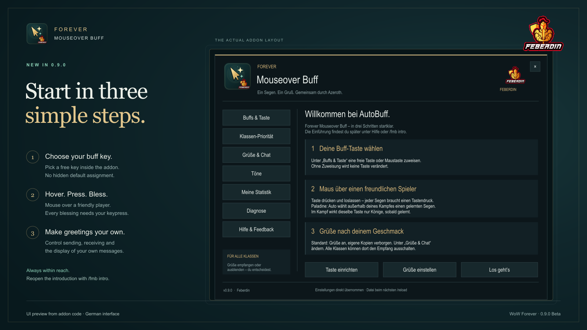
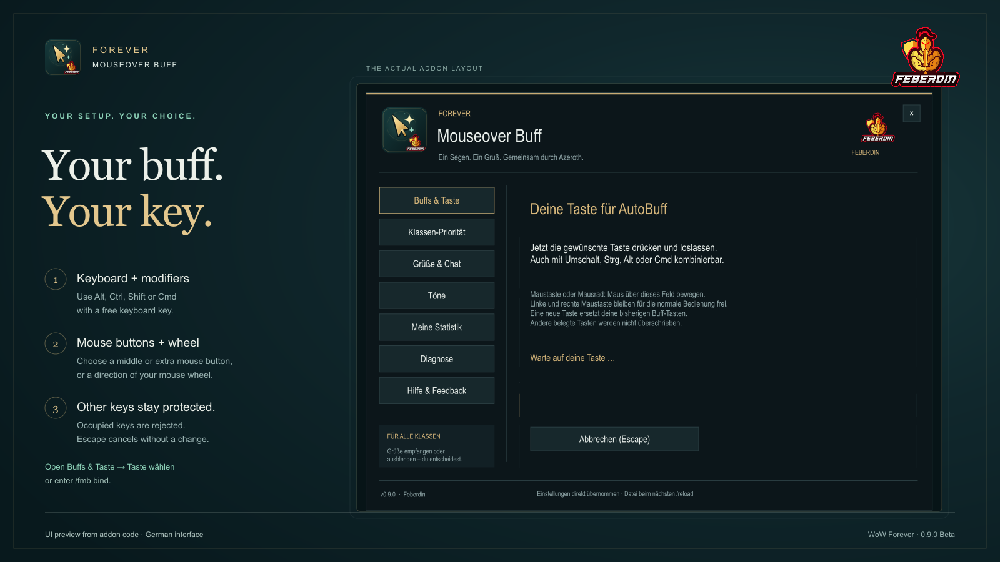

# ✨ Forever Mouseover Buff

**A useful blessing. A personal greeting. A quieter chat.**

Choose a learned Paladin blessing for the friendly player under your mouse.
Other classes can install Forever Mouseover Buff simply to decline its automatic
greetings.

**0.9.0 Beta · WoW Forever 1.60.1 · Interface 16001**

The interface and greetings are primarily German. Class priorities and the native
Sanctum menu have automated behavior and offline layout coverage. Live gameplay
and receipt of greetings by another player still need in-game acceptance.

## 🛡️ What it does

- **Mouseover blessings:** outside your own combat, choose a useful learned
  Blessing of Might, Wisdom or Kings from the supported class presets.
- **Respect existing buffs:** selection uses readable target information and
  preserves existing blessings. When essential information is unclear or
  protected, it stops with a reason.
- **Combat binding:** once learned, Kings is available on the same mouseover key
  during your combat. This is a fixed binding, without dynamic buff selection.
- **Helpful feedback:** a blocked attempt gives a short explanation and an
  optional sound. A separate cue can announce an observed natural seal expiry.
- **Personal greetings:** after a confirmed FMB buff, send a rotating German
  greeting with appropriate class/race language and the actual spell link when
  available.

**Every cast requires a real keypress.** Hovering alone never casts a spell.
Buff selection and statistics currently support **Paladins only**. Receiver-only
use works for **every class**; the other greeting styles do not add their spells.

## 🚀 Start in a minute

1. Install the addon in your active Forever `Interface/AddOns` folder. For a
   manual ZIP installation, check that the folder contains
   `ForeverMouseoverBuff/ForeverMouseoverBuff.toc`.
2. Restart WoW after first installation. An update normally needs `/reload`.
3. Follow the short introduction. `/fmb` opens the controls later.
4. Paladins: choose **Taste einrichten** in the addon, or enter `/fmb bind`,
   and assign a free key. Hover a friendly player, then press and release it.
5. Only want to decline greetings? Enter `/fmb receive off`. No buff binding is
   needed, and your character can be any class.

Use `/fmb auto` for automatic selection outside combat, or choose `/fmb might`,
`/fmb wisdom` or `/fmb kings`. `/fmb on` and `/fmb off` control buff functionality.

## A short introduction and your own buff key

The introduction appears automatically once per character after installing or
updating to this version. Open it again with `/fmb intro`. It explains the
mouseover action, combat behavior and optional greetings without changing your
existing preferences. Closing it skips the introduction; ordinary later logins
keep the menu closed. You can return to it at any time.

Open `/fmb bind` or **Buffs & Taste → Taste wählen**. Start key capture and
press a free keyboard key, optionally with Alt, Ctrl, Shift or Cmd on a Mac.
You can also use the middle mouse button, mouse buttons 4/5 or the mouse wheel.
Left and right mouse buttons remain available for ordinary interaction.
The chosen key is saved
in WoW's currently active account-wide or character-specific binding set.
Choosing a new free key replaces the previous FMB keys. Selecting an existing
FMB key leaves its current assignments unchanged.

A key already assigned to another action is rejected with an explanation; choose
a free combination or free the key deliberately in WoW's key binding settings.
Escape, closing the window or entering combat cancels key capture. Binding
changes are available outside combat only. Removing the buff binding affects
only FMB's keys. No key is assigned automatically and setup never casts a spell.
The usual **Key Bindings → Forever Mouseover Buff** entry remains available.

*Preview from the addon code · German interface; not an in-game screenshot.*

## Class priorities outside combat

Open `/fmb priorities` (or **Klassen-Priorität** in the menu). Choose a recipient
class, enable the blessings you want and move them with **Hoch** / **Runter**.
The first enabled, missing, learned and level-appropriate blessing is selected.
An empty list disables automatic buffs for that class. **Standard wiederherstellen**
restores only the selected class. Preferences are saved per character on reload/logout.

Druids default to **Kings → Wisdom → Might**. For example, a Druid with Kings and
Wisdom supplied by other paladins can receive your Might. Existing blessings of
the same family are preserved regardless of rank. Your own existing Might, Wisdom
or Kings is also preserved, even if excluded from the new list: this prevents
repeated key presses from replacing your own blessing in a cycle. This is an
ordered choice of one blessing, not three simultaneous blessings from one paladin.
Use an explicit fixed mode when you intentionally want to replace your own buff.

These settings apply only to **Auto outside combat**. The combat key remains fixed
to learned Kings; manual modes ignore class priorities. Settings never cast a spell.
Unreadable aura information still blocks selection. Invalid saved priorities block
Auto with `INVALID_PRIORITIES`; correct the list in the menu or deliberately use
`/fmb priorities reset` to restore **all** classes. `CLASS_DISABLED` means all
blessings for the current class have been switched off.

## 💬 Three separate message controls

| What you want | Command | What changes |
| --- | --- | --- |
| Stop sending automatic greetings | `/fmb whisper off` | Your outgoing greeting messages |
| Decline automatic FMB greetings | `/fmb receive off` | Greetings addressed to you |
| Hide your own greetings in chat and WIM | `/fmb outgoing off` | Your local display, popups and WIM sounds |

The **Greetings & Chat** page has separate **Send automatic greetings** and
**Hide my greetings** switches. Both default to **ON**: recipients receive your
greetings while your own copies stay quiet in ordinary chat and WIM. Switch
sending off to stop automatic messages without disabling buffs. Existing explicit
preferences remain saved; `outgoing on` shows your own copies again.

Hidden automatic echoes neither open WIM windows nor trigger its sounds or
history. Normal personal whispers remain unaffected. WIM is optional. The filter
matches only recently sent automatic messages and their exact recipient; the
receiver switch recognizes compatible, marked FMB greetings, rather than every
addon or older unmarked message.

## 🔔 Sounds you control

- `/fmb sound on` or `/fmb sound off`: feedback for blocked buff attempts.
- `/fmb soundtest`: check the feedback tone while it is enabled.
- `/fmb seal on` or `/fmb seal off`: the separate seal-expiry reminder.

The seal cue follows an observed natural expiry. It does not sound simply because
you log in without an active seal.

## 📊 Local counts and optional ranking experiments

`/fmb stats` shows local, unverified counts of successful FMB buffs. Version 0.7.1
stores the twenty supported spell counters as binary data encoded in Base64,
with a SHA-256 checksum. Valid older counters migrate automatically. Damaged or
unreadable records stay unchanged; statistic updates pause while buffing remains
available.

**This is encoding with a corruption check, not encryption or anti-cheat.** A
file owner can create another payload and matching checksum. Counts remain
community/self-reported and cannot prove genuine casts.

Ranking export is **off by default**. `/fmb ranking on` starts collecting optional
export events; `/fmb ranking help` explains the separate companion and local test
workflow. The event export remains readable. No recipients or chat contents are
exported. The addon makes no web requests, and **no public ranking service is
provided**. Buffing requires neither companion nor service.

## 🧭 Local diagnostics

`/fmb diag` shows the current diagnostic status and latest five events. FMB keeps
a bounded local log of fixed codes, severity, module, optional public timestamps,
cast-attempt counts and a small settings/client-version snapshot. It never records
player names, GUIDs, whisper text or raw API errors. The log is active without chat
spam; `/fmb debug on` only adds local chat output.

WoW writes SavedVariables to disk on `/reload` or logout. The separate local reader
can inspect that saved snapshot without starting the ranking service or uploading
anything. It cannot read live game memory. An old file is not a live health check.

## ❓ Common questions

**Can I buff a player who is fighting?**  
Yes, their combat state alone does not prevent it. Selection still needs usable
target information. Your own combat switches the binding to learned Kings.

**What should I include in a bug report?**  
Use `/fmb status`, `/fmb help` and temporarily `/fmb debug on`. Share your version,
client build, reproduction steps and fixed diagnostic code.
Turn logging back off with `/fmb debug off`. Never share complete SavedVariables,
private whispers, tokens or access backups. Preserve damaged statistics before
attempting recovery; do not reset them just to hide an error.

---

An independent **MIT-licensed** project. Not affiliated with Blizzard or
CurseForge. WoW names and trademarks belong to their respective owners.

Source and issues: [GitHub](https://github.com/Feberdin/ForeverMouseoverBuff) · [Issues](https://github.com/Feberdin/ForeverMouseoverBuff/issues).
